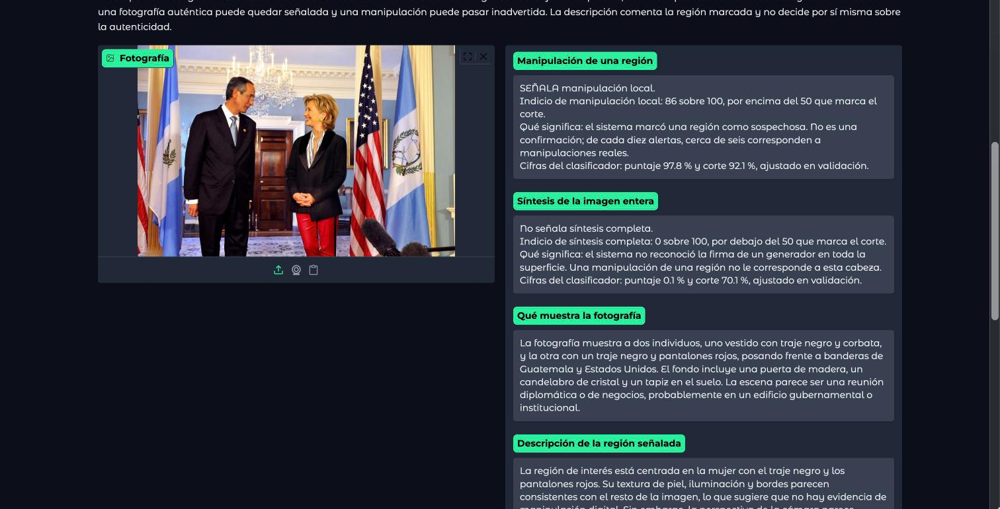

# Detección explicable de imágenes generadas por inteligencia artificial en contenido político guatemalteco

Módulo de sistema integral de detección. Trabajo Profesional, Proyecto de Graduación 2026,
Universidad del Valle de Guatemala.

Prototipo público: [huggingface.co/spaces/HugoRiv/deteccion-explicable-imagenes-politicas](https://huggingface.co/spaces/HugoRiv/deteccion-explicable-imagenes-politicas)

## Descripción

Las imágenes generadas o manipuladas mediante inteligencia artificial circulan en la
comunicación política, y verificarlas requiere herramientas accesibles, explicables y adaptadas
al contexto guatemalteco. El proyecto evalúa la viabilidad de un sistema automatizado que las
detecte combinando análisis forense y un modelo de visión y lenguaje.

Cómo funciona:

- **Corpus pareado.** 494 parejas de fotografías políticas auténticas de Guatemala, Estados
  Unidos, México y Canadá con su versión editada localmente, más 300 imágenes de síntesis
  completa (200 pareadas y 100 libres). Las ediciones y las imágenes sintéticas se produjeron
  con Stable Diffusion XL.
- **Dos clasificadores independientes.** Uno busca la manipulación de una región y otro la
  síntesis de la imagen entera. Ambos son ResNet18 inicializadas en ImageNet y ajustadas sobre
  parches de 256 píxeles; cada uno decide con un corte ajustado en el conjunto de validación.
- **Descripción explicable.** Qwen2.5-VL-7B describe la escena y la región señalada. Comenta lo
  que observa y no decide sobre la autenticidad.
- **Prototipo.** Interfaz Gradio desplegada en Hugging Face Spaces con ZeroGPU. Devuelve los dos
  indicios en una escala de 0 a 100 con el corte en 50, el mapa de sospecha, la región señalada,
  su descripción y los avisos que acotan cada resultado.

Desempeño medido:

| Componente | Resultado |
|---|---|
| Manipulación local, conjunto de prueba | AUC 0.638 [0.539, 0.734]; F1 0.519 [0.404, 0.630] |
| Síntesis completa | AUC 0.999 en imágenes pareadas y 0.988 en libres, sobre 24 y 12 imágenes del mismo generador del entrenamiento |
| Descripción de la región | Pertinente en 107 de 120 casos, 0.892 [0.823, 0.936] |

El alcance queda limitado por el desempeño ante la manipulación local, por una sola familia de
generadores y por la falta de pruebas con imágenes difundidas en redes. Ninguna edición del
corpus recae sobre rostros. La ausencia de alerta no demuestra que una imagen sea auténtica.

## Tecnologías Utilizadas

- Python 3.10
- PyTorch y torchvision (ResNet18)
- Transformers y Accelerate (Qwen2.5-VL-7B-Instruct)
- Gradio
- Hugging Face Spaces (ZeroGPU) y Hugging Face Hub
- Stable Diffusion XL
- NumPy, SciPy, OpenCV, Pillow y Matplotlib
- pytest
- Google Colab

## Requisitos Previos

- Python 3.10 o superior, con `pip`
- Git
- Para ejecutar el prototipo con los modelos reales: GPU NVIDIA con al menos 24 GB de memoria.
  Qwen2.5-VL-7B no cabe en una T4 de 15 GB.
- Conexión a internet la primera vez, para descargar los puntos de control y Qwen2.5-VL.

Sin GPU se puede usar el prototipo publicado o el modo de demostración de la interfaz
(paso 6).

## Instalación

1. Clonar el repositorio y entrar a la carpeta:

   ```bash
   git clone https://github.com/GraduacionesUVG/2026-22500-rivas-fajardo-hugo-eduardo.git
   cd 2026-22500-rivas-fajardo-hugo-eduardo
   ```

2. Crear el entorno e instalar las dependencias del prototipo:

   ```bash
   cd src/prototipo
   python3 -m venv .venv
   source .venv/bin/activate
   pip install -r requirements.txt
   ```

3. Configurar las variables de entorno copiando `src/.env.example` a `src/.env`, completar
   `REPO_PESOS=HugoRiv/deteccion-explicable-imagenes-politicas-pesos` y cargarlas:

   ```bash
   cp ../.env.example ../.env
   set -a; source ../.env; set +a
   ```

4. Descargar los puntos de control publicados en el Hub:

   ```bash
   python -c "from huggingface_hub import hf_hub_download as d; [d('HugoRiv/deteccion-explicable-imagenes-politicas-pesos', f, local_dir='.') for f in ('imagenet_ajustado.pt', 'sintesis.pt')]"
   ```

5. Ejecutar el prototipo. Lee las rutas de los puntos de control y de las tablas desde las
   variables del paso 3:

   ```bash
   python app.py
   ```

   La interfaz queda en `http://127.0.0.1:7860`.

6. Sin GPU, revisar la interfaz en modo de demostración. Usa dobles del detector y del modelo,
   de modo que la salida es simulada y la interfaz lo indica:

   ```bash
   python app.py --demostracion
   ```

7. Opcional: correr las pruebas de los instrumentos del análisis. La suite completa se ejecutó
   en Google Colab con GPU.

   ```bash
   cd ../analisis
   python3 -m venv .venv
   source .venv/bin/activate
   pip install -r requirements.txt
   pytest
   ```

El detalle de cada carpeta de código está en [`/src/README.md`](src/README.md).

## Capturas

La carpeta [`/capturas`](capturas) contiene 14 capturas del prototipo en funcionamiento (mínimo
requerido: 10), tomadas sobre el Space publicado.

| Captura | Contenido |
|---|---|
| [`captura-01`](capturas/captura-01.jpg) | Portada del prototipo en Hugging Face Spaces |
| [`captura-02`](capturas/captura-02.jpg) | Recuadro de carga y cajas de salida vacías |
| [`captura-03`](capturas/captura-03.jpg) | Análisis en curso de una fotografía auténtica |
| [`captura-04`](capturas/captura-04.jpg) | Caso 1, fotografía auténtica: no señala manipulación local (46 sobre 100) ni síntesis (2 sobre 100) |
| [`captura-05`](capturas/captura-05.jpg) | Caso 1: aviso de que ningún clasificador superó su corte, mapa y región |
| [`captura-06`](capturas/captura-06.jpg) | Caso 2, edición local evidente: señala manipulación local (86 sobre 100) |
| [`captura-07`](capturas/captura-07.jpg) | Caso 2: mapa de sospecha y región señalada sobre la zona editada |
| [`captura-08`](capturas/captura-08.jpg) | Caso 2: descripción de la región y aviso de términos de autenticidad |
| [`captura-09`](capturas/captura-09.jpg) | Caso 3, edición local sutil: no la señala (39 sobre 100), falso negativo |
| [`captura-10`](capturas/captura-10.jpg) | Caso 3: el recuadro marca otra zona de la imagen |
| [`captura-11`](capturas/captura-11.jpg) | Caso 4, síntesis completa: señala síntesis (71 sobre 100) y no manipulación local (49 sobre 100) |
| [`captura-12`](capturas/captura-12.jpg) | Caso 4: aviso de síntesis, mapa y región |
| [`captura-13`](capturas/captura-13.jpg) | Caso 5, fotografía reducida a 900 × 600: señala manipulación local (87 sobre 100) |
| [`captura-14`](capturas/captura-14.jpg) | Caso 5: aviso de resolución por debajo de la escala validada |



## Demo

Video demostrativo con narración: [`/demo/demo.mp4`](demo/demo.mp4). Dura 4:52 y recorre el
sistema, la interfaz y los cinco casos de las capturas, y cierra con el desempeño medido.

## Documentación

- Informe final: [`/docs/informe_final.pdf`](docs/informe_final.pdf)
- Consentimiento de uso de foto y video firmado: [`/docs/consentimiento_firmado.pdf`](docs/consentimiento_firmado.pdf)
- Puntos de control publicados: [huggingface.co/HugoRiv/deteccion-explicable-imagenes-politicas-pesos](https://huggingface.co/HugoRiv/deteccion-explicable-imagenes-politicas-pesos)

## Autores

- Hugo Eduardo Rivas Fajardo, carné 22500. Ingeniería en Ciencias de la Computación y TI,
  Universidad del Valle de Guatemala.
- Asesor: Ing. Javier Fong.

## Licencia

MIT, la misma del prototipo y de los puntos de control publicados en Hugging Face.
